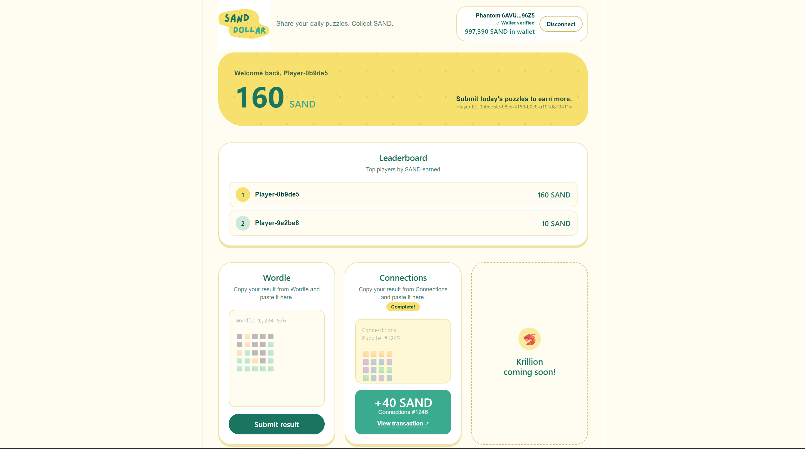

# Sand Dollar

**Share your daily puzzles. Collect SAND.**

Sand Dollar is a web app that rewards you with SAND, a token on Solana, for sharing your daily Wordle and Connections results. Paste your result, and the reward is sent straight to your Phantom wallet.

Built for the **MLH Solana Hackathon 2026**.

<!-- TODO: add a logo or screenshot -->


- **Live demo:** TODO
- **Demo video:** TODO
- **Devpost:** TODO

---

## Why we built it

Millions of people play puzzle games like Wordle and Connections everyday. Sand Dollar turns that habit into a small daily reward, and makes a first Solana transaction feel friendly instead of technical. There are no addresses to copy around and no jargon: paste your result and you get paid.

## Features

- **Paste to earn.** Copy your result from Wordle or Connections, paste it into the matching card, and receive SAND.
- **On-chain payouts.** Each reward is a real transaction on Solana (devnet), with a link to view it on Solana Explorer.
- **One reward per game per day.** Puzzle dates follow Eastern Time, so each game can be claimed once per puzzle day.
- **Phantom wallet linking.** Connect Phantom and prove you own the wallet by signing a message. No transaction or fee is needed to link it.
- **Balance and history.** See your SAND balance, your wallet's on-chain balance, and a feed of recent submissions and rewards.
- **Leaderboard.** See the top players ranked by total SAND earned.
- **Room to grow.** Each game is a self-contained card built on a shared `GameCard`, so adding a new game is mostly a new parser and endpoint.

## How it works

1. **Sign in** to your Sand Dollar account.
2. **Connect Phantom** and click *Verify and link wallet*. The backend issues a challenge message, you sign it in Phantom, and the backend checks the signature and links the wallet to your account.
3. **Play today's puzzle**, then use the game's share button to copy your result.
4. **Paste it** into the Wordle or Connections card and press *Submit result*.
5. The backend **validates and parses** the result, records the submission, and sends the **SAND payout** to your linked wallet.
6. The dashboard shows your reward and a **link to the transaction** on Solana Explorer.

## Tech stack

| Layer | Tools |
| --- | --- |
| Frontend | React, Tailwind CSS |
| Wallet | Phantom, `@solana/kit-plugin-wallet`, `@solana/react` |
| Backend | FastAPI (Python) |
| Blockchain | Solana (devnet), SAND token |
| Fonts | Fredoka and Nunito |

<!-- TODO: add your database, hosting, and any other services (e.g. RPC provider) -->

## API overview

The frontend talks to the backend through these endpoints:

| Method | Endpoint | Purpose |
| --- | --- | --- |
| GET | `/users/me` | Current user profile |
| GET | `/users/me/balance` | SAND balance for the account |
| GET | `/users/me/submissions` | Submission and reward history |
| POST | `/games/wordle/submit` | Submit a Wordle result |
| POST | `/games/connections/submit` | Submit a Connections result |
| POST | `/wallet/challenge` | Request a message to sign |
| POST | `/wallet/verify` | Verify the signature and link the wallet |
| GET | `/leaderboard` | Top players by SAND earned |

## Getting started

### Prerequisites

- Node.js 18+
- Python 3.10+
- The [Phantom](https://phantom.app) browser extension, set to **Devnet**
  (Settings → Developer Settings → Testnet Mode, then choose Solana Devnet)

### Backend

```bash
cd backend            # TODO: confirm folder name
python -m venv .venv
source .venv/bin/activate
pip install -r requirements.txt
cp .env.example .env  # TODO: list required variables below
uvicorn main:app --reload   # TODO: confirm module path
```

Environment variables (TODO: fill in):

| Variable | Description |
| --- | --- |
| `TODO` | e.g. Solana RPC URL |
| `TODO` | e.g. payout wallet keypair |
| `TODO` | e.g. SAND token mint address |
| `TODO` | e.g. database URL |

### Frontend

```bash
cd frontend           # TODO: confirm folder name
npm install
npm run dev
```

## Notes and limitations

- Sand Dollar runs on **Solana devnet**, so SAND has no real-world value.
- Results are submitted by pasting share text, so the backend has to rely on validating that text. <!-- TODO: describe any anti-abuse measures you added -->

## What's next

- More games (the dashboard already has a slot for them)
- Streaks and bonus rewards for playing consistently
- <!-- TODO: your ideas, e.g. mainnet, friend groups, more wallets -->

## Team
Developed by Ayaan Modak (GitHub: Iced-code)

## License

<!-- TODO: e.g. MIT -->